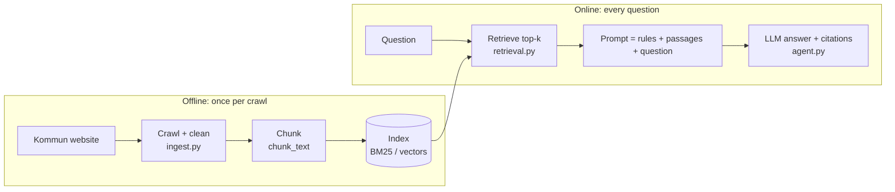

# Learn RAG with this project

Eight short lessons that use **your own index of a real kommun website**. Each one explains a
concept, points to where it lives in this code, runs an experiment you can change, and ends
with an exercise. Run every script from the repo root, with your venv active.

## The whole picture first

RAG (retrieval-augmented generation) = before the model answers, **retrieve** the passages
that contain the answer and put them in the prompt. The model then **generates** an answer
grounded in those passages, with citations.

Every quality problem lives in one of those boxes. The skill is finding **which one**.

| Stage | Where in your code | What goes wrong | Lesson |
| --- | --- | --- | --- |
| Crawl + clean | `ingest.py` `crawl`, `extract_text` | Wrong pages, menus and footers in the text | (you already fixed two) |
| Chunk | `ingest.py` `chunk_text` | Answer split across chunks, no context | 1 |
| Retrieve: keywords | `retrieval.py` `Retriever` | Synonyms, English questions, compounds | 2 |
| Retrieve: meaning | `learn/_common.py` `EmbeddingIndex` | Exact names and numbers | 3 |
| Combine | `learn/_common.py` `rrf` | | 4 |
| Rerank | `learn/_common.py` `rerank` | Top 5 is related but doesn't answer | 5 |
| Generate | `agent.py` `SYSTEM_PROMPT` | Hallucination, made-up citations | 6 |
| Measure | `learn/07_measure_retrieval.py`, `evals/` | You can't tell if a change helped | 7 |
| Agentic RAG | `agent.py` + `tools.py` | Loops, too many searches | 8 |

## Lessons

About 4–6 hours in total. Lessons 3–7 use Gemini embeddings (free tier) from your
`GEMINI_API_KEY`. Without a key they still run with `LEARN_OFFLINE=1`, using a keyword-based
stand-in, so you can see the mechanics but not real semantic search.

Before you start, re-crawl with your new config so the index has the real service pages:
`kommun-agent ingest`.

### 1. Chunking: what the model actually reads (30 min)
`python learn/01_chunks.py` then try `--size 60` and `--size 400`.

### 2. Keyword search (BM25): why a page wins (30 min)
`python learn/02_bm25.py "hur ansöker jag om förskoleplats"`
Write down 3 queries that fail. You'll fix them in lessons 3 and 4.

### 3. Embeddings: search by meaning (45 min)
`python learn/03_embeddings.py` (the first run embeds and caches every chunk).

### 4. Hybrid search with Reciprocal Rank Fusion (30 min)
`python learn/04_hybrid.py "Stålhamraskolan" "plats på dagis"`

### 5. Reranking (30 min)
`python learn/05_rerank.py "Behöver jag bygglov för en altan?"`

### 6. Grounding: the "G", and how it fails (30 min)
`python learn/06_grounding.py "Vad kostar förskola per månad?"`
Runs the same question with no retrieval, with the right passages, and with the wrong ones.

### 7. Measure retrieval (45 min)
`python learn/07_measure_retrieval.py` then `--rerank`.
Prints Hit@1, Hit@5 and MRR for BM25, embeddings, hybrid and reranked results, based on
`learn/retrieval_set.yaml`. **Copy the table into the README.** It's the strongest thing in
this repo for an interview.

### 8. Agentic RAG: what your agent already does (reading + exercise, 45 min)
Classic RAG retrieves once, before the model sees the question. Your agent is different: search
is a **tool**, so the model decides what to search for, rewrites the query (it searched
"ansöka förskoleplats", then "förskola plats" on its own), searches again if results are weak,
and decides when it has enough.

| | Classic pipeline RAG | Agentic RAG (this project) |
| --- | --- | --- |
| Query | User's words as-is | Model rewrites it, can search several times |
| Cost and latency | 1 retrieval + 1 LLM call | 2–4 LLM calls per question |
| Failure mode | Bad query, bad results | Loops, over-searching (you hit this: 6 searches) |
| Control | Predictable | Needs budgets and a forced final answer (you added both) |

Exercise: open `logs/traces.jsonl` and, for 10 questions, look at the queries the model chose.
Would retrieval have worked with the user's raw question? Then wire your hybrid retriever into
the `search_kommun_info` tool (lesson 4, exercise 2) and compare eval scores.

## Interview cheat sheet

Answer these out loud using your own numbers from lesson 7.

- **What is RAG, and why not just fine-tune?** RAG gives the model up-to-date, citable facts
  at query time. Fine-tuning changes behaviour and style but is bad at storing facts that change
  (fees, deadlines) and can't cite a source. For a kommun, citations matter.
- **Your answers are wrong. How do you debug?** First split retrieval from generation: was
  the right passage in the top k? (Lesson 7.) If not, fix crawl, chunking or search. If it was,
  fix the prompt or model (lesson 6).
- **BM25 or embeddings?** Both: hybrid with RRF. BM25 for names, codes and exact terms;
  embeddings for synonyms, paraphrases and other languages. Then rerank.
- **How do you choose chunk size?** Measure it. Start around 200–500 tokens with overlap, split
  on headings, and add the page title and heading to each chunk. Compare Hit@k.
- **How do you stop hallucinations?** Ground the prompt ("only from the passages, otherwise
  say you don't know"), require citations, check that cited URLs were actually retrieved, and
  score groundedness with an LLM judge in CI.
- **How would this run in production?** Scheduled re-crawls with change detection, a vector
  DB with an ANN index (pgvector / HNSW), hybrid search plus a reranker, PII redaction, traces
  and a dashboard, and evals on every prompt or model change. On Salesforce: Data 360 for
  ingestion and vector search, with Agentforce actions calling it.
- **Agentic or pipeline RAG?** Pipeline when questions are simple and latency and cost
  matter. Agentic when questions need several lookups or query rewriting, with step budgets.
