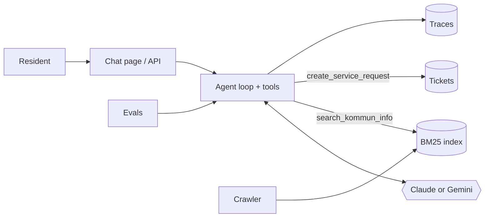

# kommun-agent

An AI agent that answers residents' questions about Swedish municipal services, using only
the municipality's own web pages, and hands cases to a human when it should.

Point it at any kommun's website with one config file, and run it on **Claude or Gemini**
(one setting in `.env`).

> **Demo:** _add a GIF or 60-second video here_
> **Eval results:** _add your latest score here, e.g. "11/12 cases pass, groundedness 4.6/5"_

## What it does

- **Answers with sources.** Every factual answer links to the kommun pages it came from.
- **Says "I don't know".** If the pages don't cover it, it says so instead of guessing fees, dates or rules.
- **Takes action.** When a resident asks about their own case, an appeal or a complaint, it creates a
  service request and returns a ticket id.
- **Handles the tricky cases safely:** emergencies (points to 112), off-topic questions, prompt
  injection, and residents who paste their personnummer.
- **Replies in the resident's language** (Swedish, English, others).
- **Is measurable.** An eval suite with deterministic checks plus an optional LLM-as-judge groundedness
  score, and a trace log of every conversation (tools, tokens, latency).

## Architecture



More detail and the design trade-offs: [docs/architecture.md](docs/architecture.md).

## Quick start

Requires Python 3.10+ and an API key for either
[Gemini](https://aistudio.google.com/apikey) (has a free tier) or [Claude](https://console.anthropic.com/).

```bash
python -m venv .venv && source .venv/bin/activate
pip install -e ".[dev]"
cp .env.example .env          # set LLM_PROVIDER and add that provider's key

# 1. Choose a municipality: edit config/kommun.yaml (Södertälje by default)
# 2. Crawl its public pages and build the index (~150 pages, a few minutes)
kommun-agent ingest

# 3. Ask
kommun-agent ask "Hur ansöker jag om plats i förskola?"
kommun-agent chat             # multi-turn in the terminal
kommun-agent serve            # web chat at http://localhost:8000
```

With Docker:

```bash
docker build -t kommun-agent .
docker run --env-file .env -v "$PWD/data:/app/data" kommun-agent kommun-agent ingest
docker run --env-file .env -v "$PWD/data:/app/data" -p 8000:8000 kommun-agent
```

## Evals

```bash
python evals/run_evals.py           # 12 cases, deterministic checks
python evals/run_evals.py --judge   # + groundedness score 1-5 from an LLM judge
```

Each case in [evals/questions.yaml](evals/questions.yaml) checks things like: did it cite a page on
the kommun's domain, did it escalate when it should (and only then), did it mention 112 in an
emergency, did it refuse to reveal its prompt, did it avoid repeating a personnummer.
Results go to `evals/results/latest.md`.

**Compare providers** on the same cases:

```bash
LLM_PROVIDER=gemini python evals/run_evals.py --judge
LLM_PROVIDER=claude python evals/run_evals.py --judge
```

| Provider · model | Passed | Groundedness | Avg tokens | Avg latency |
| --- | --- | --- | --- | --- |
| _gemini · ..._ | _x/12_ | _x/5_ | _..._ | _...s_ |
| _claude · ..._ | _x/12_ | _x/5_ | _..._ | _...s_ |

**Prompt-failure log** (fill this in as you iterate; interviewers ask about it):

| Version | What failed | Why | Change | Result |
| --- | --- | --- | --- | --- |
| v1 | _e.g. "förskoleplats" found nothing_ | _BM25 doesn't split compound words_ | _told the model to retry with split words_ | _x/12 → y/12_ |

## Project layout

```
src/kommun_agent/
  ingest.py      polite crawler (robots.txt, one domain, rate-limited) + chunking
  retrieval.py   BM25 search over chunks
  tools.py       tool schemas + execution (search, create service request)
  providers.py   Claude and Gemini adapters behind one interface
  agent.py       provider-neutral tool-use loop, system prompt, tracing
  api.py         FastAPI: /api/chat, /api/info, /health, web page
  cli.py         ingest | ask | chat | serve
evals/           eval cases + runner
tests/           offline unit tests (fake LLM, no API key needed)
```

## Privacy

This is a demo. Tickets and traces are stored as local files. The agent is told never to ask for
a personnummer or sensitive data, and an eval checks that it doesn't repeat one. A production
version would add PII redaction on input and in logs, data retention rules, and a DPIA (GDPR).

## Next steps

- [ ] Hybrid retrieval: embeddings (pgvector) + BM25, with Swedish compound-word splitting
- [ ] Observability dashboard over `logs/traces.jsonl`: resolution rate, escalations, cost, unanswered questions
- [ ] Load open data (SCB, Skolverket) into Postgres and expose it as a typed tool
- [ ] Deploy to AWS (App Runner or ECS) with the evals running in CI
- [ ] Salesforce Agentforce version: same tools as Agentforce actions calling this API
