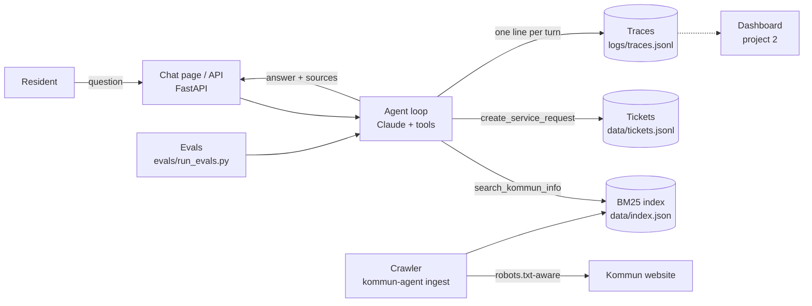

# Architecture

## Request flow

1. The resident's message and earlier turns go to Claude with two tools and a system prompt.
2. Claude searches (often 1-3 times with different Swedish phrasings), reads passages, and either
   answers with source links or creates a service request.
3. The loop stops when Claude returns a normal answer, or after `max_steps` (default 6) as a guard.
4. Every turn is written to `logs/traces.jsonl`: tools used, tokens, latency, sources, tickets.

## Why these choices

| Decision | Why | What I'd do in production |
| --- | --- | --- |
| BM25 keyword search | Runs with one API key, no vector DB, easy to inspect | Hybrid search: embeddings (pgvector) + BM25, Swedish compound splitting |
| Answers only from retrieved pages | A wrong fee or deadline from a municipality is worse than "I don't know" | Same, plus a groundedness check before replying |
| Ticket tool writes to a file | Shows the agent taking a real action | Call the kommun's case-management or CRM API |
| Never asks for personnummer | GDPR and data minimisation | PII redaction on input and in logs |
| Evals in the repo | Prompt changes are tested like code | Run evals in CI on every prompt change |
